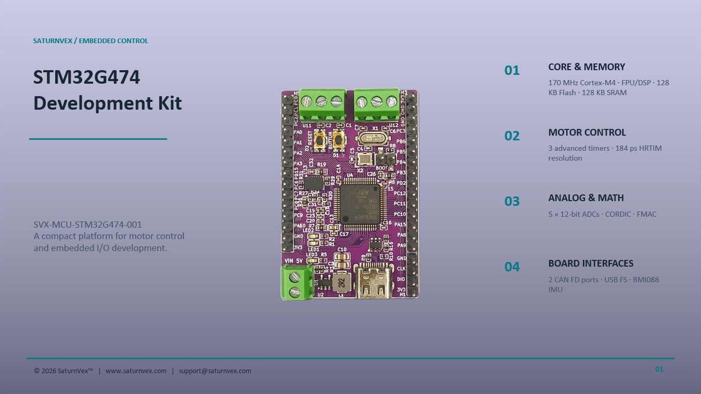
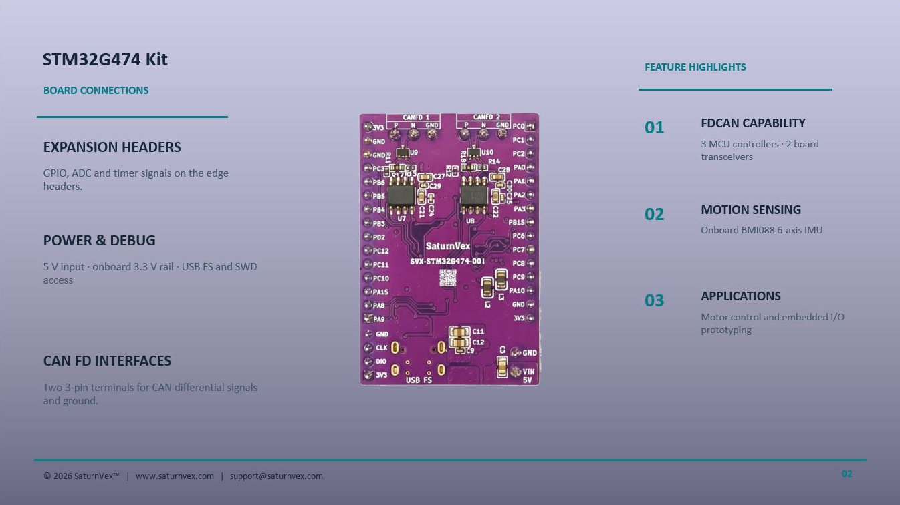
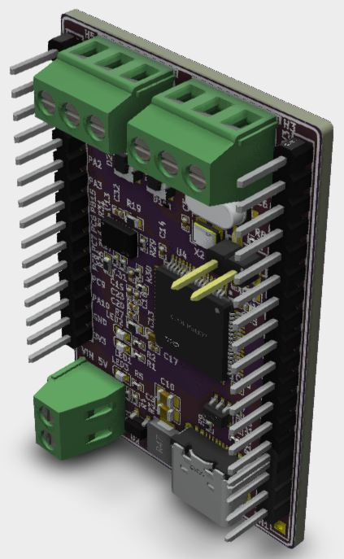

<strong>SATURNVEX · EMBEDDED CONTROL</strong>

<!-- Two full-width cover images; GitHub constrains content to the README panel width. -->

# SVX-MCU-STM32G474 — Development Kit

*SaturnVex™ — embedded hardware, firmware and Edge AI platforms*

A compact STM32G474RBT6 development board for embedded I/O, motor-control experimentation, CAN FD communication and sensor integration.

## Product specifications

| Item | Specification |
|---|---|
| Product code | `SVX-MCU-STM32G474-001` |
| MCU | STM32G474RBT6, Arm Cortex-M4, up to 170 MHz |
| Memory | 128 KB Flash, 128 KB SRAM |
| Board dimensions | **35 × 51 mm (PCB)** |
| Supply | 5 V board input, on-board 3.3 V rail |
| Interfaces | Dual CAN FD transceivers, USB Full-Speed, SWD, expansion headers |
| Sensors | BMI088 6-axis IMU (on-board) |
| Test projects provided | Dual FDCAN, USB Bulk, PWM6, ICM-45686 SPI3, LED/GPIO, ADC1 8-channel, BMI088 SPI1, BMM350 I2C2 |

## Documentation

| Resource | File |
|---|---|
| **Board quick configuration guide** | [Open PDF](docs/SaturnVex_SVX-MCU-STM32G474-001_Quick_Configuration_Guide_EN.pdf) |
| **Firmware test guides and source projects** | [Browse tests](tests/README.md) |
| **Mechanical CAD (35 × 51 mm)** | [CAD files / STEP](cad/README.md) |
| **Download all available documentation and code** | [Download complete package](downloads/SVX-MCU-STM32G474-001_Complete_Resources.zip) |

## Test projects — documentation paired with source

| Test | Test guide (PDF) | Source (ZIP) | Overview |
|---|---|---|---|
| 01 — Dual FDCAN & Button | [Guide](tests/01-fdcan-button/SaturnVex_STM32G474_FDCAN_Button_Test_Guide_EN.pdf) | [Source](tests/01-fdcan-button/STM32G474_FDCAN_BUTTON_REVERSE_SaturnVex.zip) | [Open](tests/01-fdcan-button/README.md) |
| 02 — USB Full-Speed Bulk Echo | [Guide](tests/02-usb-bulk/SaturnVex_STM32G474_USB_Bulk_Test_Guide_EN.pdf) | [Source](tests/02-usb-bulk/STM32G474_USB_BULK_LED_SaturnVex.zip) | [Open](tests/02-usb-bulk/README.md) |
| 03 — Six-Channel PWM | [Guide](tests/03-pwm6/SaturnVex_STM32G474_PWM6_Test_Guide_EN.pdf) | [Source](tests/03-pwm6/STM32G474_PWM6_Test_SaturnVex.zip) | [Open](tests/03-pwm6/README.md) |
| 04 — ICM-45686 SPI3 IMU | [Guide](tests/04-icm45686-spi3/SaturnVex_STM32G474_ICM45686_Test_Guide_EN.pdf) | [Source](tests/04-icm45686-spi3/STM32G474_ICM45686_SPI3_SaturnVex.zip) | [Open](tests/04-icm45686-spi3/README.md) |
| 05 — LED & GPIO Output Toggle | [Guide](tests/05-led-gpio/SaturnVex_STM32G474_LED_GPIO_Test_Guide_EN_Final.pdf) | [Source](tests/05-led-gpio/STM32G474_LED_IO_Toggle_SaturnVex.zip) | [Open](tests/05-led-gpio/README.md) |
| 06 — ADC1 8-Channel & LED | [Guide](tests/06-adc1-8ch/SaturnVex_STM32G474_ADC1_8CH_Test_Guide_EN_Final.pdf) | [Source](tests/06-adc1-8ch/STM32G474_ADC1_8CH_LED_SaturnVex.zip) | [Open](tests/06-adc1-8ch/README.md) |
| 07 — BMI088 SPI1 1 kHz DRDY | [Guide](tests/07-bmi088-spi1/SaturnVex_STM32G474_BMI088_Test_Guide_EN.pdf) | [Source](tests/07-bmi088-spi1/STM32G474_BMI088_1kHz_DRDY_SaturnVex.zip) | [Open](tests/07-bmi088-spi1/README.md) |
| 08 — BMM350 I2C2 Magnetometer | [Guide](tests/08-bmm350-i2c2/SaturnVex_STM32G474_BMM350_Test_Guide_EN.pdf) | [Source](tests/08-bmm350-i2c2/STM32G474_BMM350_I2C2_SaturnVex.zip) | [Open](tests/08-bmm350-i2c2/README.md) |

**Getting started:** Read the [Quick Configuration Guide](docs/SaturnVex_SVX-MCU-STM32G474-001_Quick_Configuration_Guide_EN.pdf) before flashing or connecting CAN networks. Each test project has separate setup and acceptance criteria. The ICM-45686 test uses a sensor connected for that test, separate from the BMI088 on-board feature.

## CAD data

**Nominal PCB dimensions: 35 × 51 mm.** Download the original [STEP model](cad/STM32G474RBT6_KIT.step) for mechanical integration.

## Complete download

[**Download all supplied documentation, STEP CAD, and eight paired example projects**](downloads/SVX-MCU-STM32G474-001_Complete_Resources.zip).

You can alternatively use **Code → Download ZIP** in GitHub to download the repository.

## Where to Buy

For availability, pricing and purchase inquiries, contact **[support@saturnvex.com](mailto:support@saturnvex.com)**.

## Notes

- The PDFs describe specific test setups and expected results, not a blanket certification claim.
- Preserve STM32 HAL/CMSIS and other third-party licensing notices when redistributing firmware.
- Inspect the CAN termination configuration before connecting the board to an existing bus.

---
© 2026 **SaturnVex™** · [www.saturnvex.com](https://www.saturnvex.com) · support@saturnvex.com
