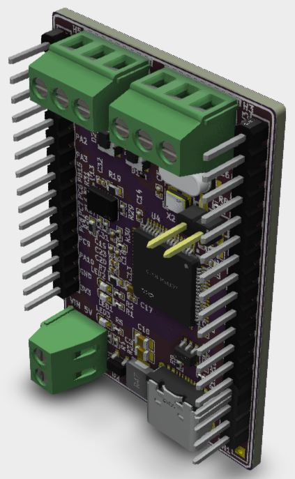

# Mechanical CAD

**PCB outline:** 35 × 51 mm (width × length, as supplied by SaturnVex). This is the nominal board footprint; verify mounting and total assembly envelope from the STEP model.

- [Download STEP 3D CAD model](STM32G474RBT6_KIT.step?raw=true)
- [View CAD rendering](STM32G474RBT6_KIT_CAD_3D_View.jpg)

[← Product home](../README.md)
